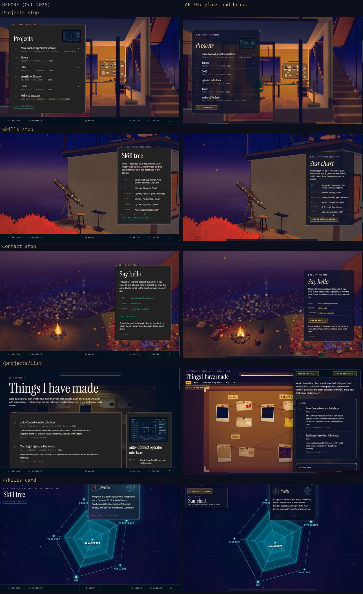
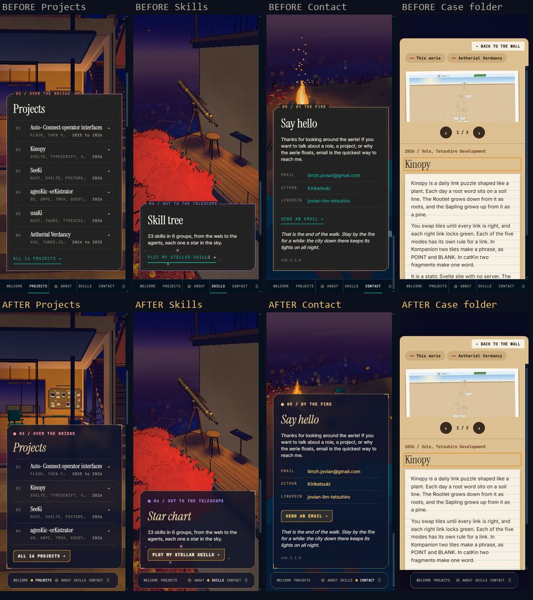
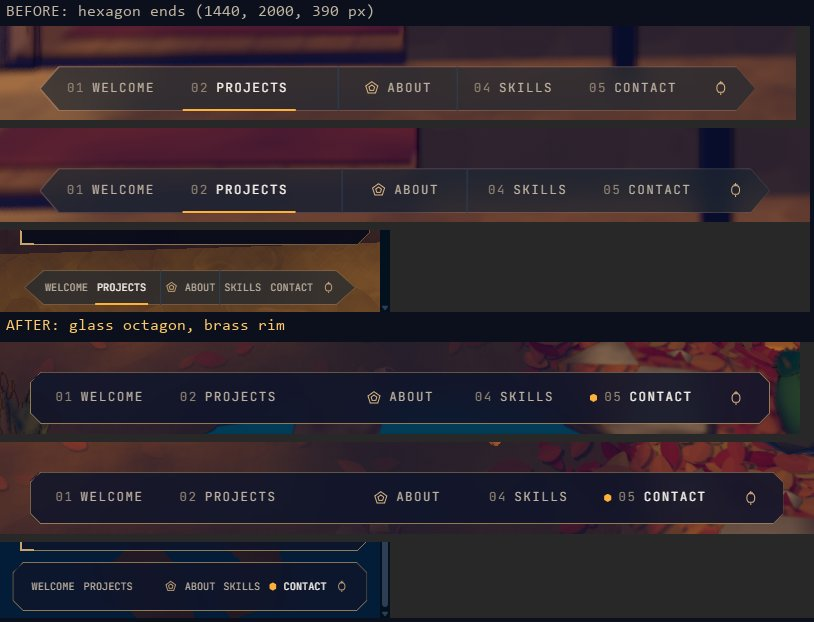

# Night glass: the design system of tetsuhiro.dev

The 2D layer of the site is a set of instruments that belong to the aerie. Each panel is a pane
of dark glass in a brass ring. The scene stays visible through the glass. The system mixes three
sources:

- **Night glass**, direction B of the 2D UI overhaul (3 November 2026). The skill sky cards were
  the first night glass panes.
- **Chrysaki**, the owner's own design system: zero radius, jewel colours, a glass stack, the
  blonde accent, and the hex mark.
- **HEX-Datum**, the owner's ring and chamfer geometry. Its first rule: a border is a ring, the
  outer shape minus an inset copy. A border is never a `box-shadow: inset`.

## Two rules above all

1. **Glass and brass only.** Every panel, strip and control is night glass with brass fittings.
   Paper stays only for things that really are paper in the scene: the case folder, the wall
   cards, the About notes and the gate lantern. No wood, no second panel material. The owner
   tried paper and wood mixes on 3 November 2026 and chose glass and brass.
2. **No gradient, ever.** Every fill is one flat colour. A ring is one solid colour. Text is one
   colour. Grain or stars come from small marks, never from a colour ramp. A `linear-gradient`
   with hard stops that only cuts a chamfer in a mask is geometry, not a gradient, and is fine.
   Scene art (the gate's painted sky and lamp glow, the WebGL fallback sky) is not UI.

The tokens are in `src/styles/tokens.css`. The frame, the action and the rows are in
`src/index.css`. This document is the rule book. If a rule here and the code disagree, fix one
of them in the same change.

## Colour

| Token | Value | Use |
|---|---|---|
| `--color-glass` | `#0e142a` at 84% | Every pane, the nav strip, the list sheet |
| `--color-glass-deep` | `#060a1a` at 88% | Chips and focus labels on the wall |
| `--color-brass` | `#c9a46a` | Brackets, row labels, the hero readout |
| `--color-brass-soft` | brass at 70% | Every ring: panes, the nav strip, the list sheet, the /skills header |
| `--color-brass-dim` | brass at 45% | Quiet frames, chip borders |
| `--color-gold` | `#f2d9a6` | Pane titles and star names, in italics |
| `--color-action` | `#fbb13c` | Chrysaki blonde: the ring and fill of an action, a pressed chip |
| `--color-action-text` | `#fcc96a` | Action text, links, focus rings |

- Teal no longer marks an action. Teal stays a scene and branch colour.
- Each section has an accent: sand by default, rose for Projects and About, violet for Skills.
  The accent colours the legend hex only. The ring stays brass. Set it with
  `.frame-rose` or `.frame-violet`. `.frame-line` is the quiet frame for secondary panes.
- Text keeps the four cream steps: strong, body, muted, faint.

## Type

| Role | Face | Where |
|---|---|---|
| Display | Instrument Serif | The hero words (roman, cream). Pane titles (italic, gold). |
| Label | JetBrains Mono, uppercase, tracked 0.12 to 0.16 em | Legends, row labels, actions, chips, readouts |
| Body | Inter | Paragraphs and values |

A pane title is an `h2` inside `.frame`. It turns gold and italic by itself.

## The frame

`.frame` draws a pane with two pseudo-elements:

1. `::before` is the glass: flat `--color-glass` with an 8 px backdrop blur. It also carries
   the brass brackets on the two square corners, 14 px long and 2 px thick.
2. `::after` is the ring: 1 px of flat `--color-brass-soft`.

Both layers take a **mask**, never a clip-path, for two reasons:

- A clip-path stops `backdrop-filter`. A mask keeps it.
- A ring made of the outer shape minus an inset copy (`mask-composite: exclude`) keeps an even
  width along the chamfer. A `box-shadow` is always a rectangle, so it runs straight into the
  diagonal. That was the fault in the old frame.

The geometry:

- Chamfer: 12 px on the top left and bottom right corners. The other two corners are square and
  carry a bracket. A chamfer is the HEX-Datum reference. Brackets belong to HEX-Datum too.
- The masks measure the cut along the 45 degree diagonal: `12 / sqrt 2 = 8.49px` for the outer
  shape, and `(12 - w x (2 - sqrt 2)) / sqrt 2` for the inset copy. For a 1 px ring that is
  `8.07px`.
- Radius is zero everywhere (Chrysaki). Only round things are round: the logo ring of a skill
  card, the paper tag on the wall, the gate lantern.

The legend is the first line inside the pane: a small hex in the section accent, then the stop
number and the place. It no longer sits in the top rule, so the ring has no gap.

Do not put `filter` on a `.frame`: it makes the frame its own backdrop root, and the glass then
blurs nothing. The sky card does this on purpose (its glow matters more than the blur there).

## Actions, links and chips

- `.action` is a small brass key: a 1 px blonde ring and a faint blonde fill, with 6 px chamfers
  on the same two corners as the frame. One mask draws both (`4.24px` is `6 / sqrt 2`). Focus
  makes the ring 2 px and the text cream. An arrow follows the label.
- `.text-link` is blonde text that takes an underline on hover and on focus.
- A chip on the wall is a square key: a dim brass border on deep glass. A pressed chip is a solid
  blonde key with navy text. Chips have square corners, so a plain `border` is correct for them.
- Focus is always visible: a 2 px `--color-action-text` outline or a thicker ring.

## Motion

- Panels arrive with the section fade that `Home.vue` already runs (0.6 s). The sky card rises
  0.5 rem in 0.35 s.
- The hero words decode from noise once.
- Nothing else moves at rest. Hover changes colour only, in 0.2 s.
- `prefers-reduced-motion` turns every one of these off.

## Density

- A home pane holds one title, one short paragraph or list, and one action.
- The Projects pane shows six rows on a wide screen and four on a phone. The wall and the list
  page hold the rest.
- Rows share one grid: number, title, mark. The stack and the year sit on a small line under the
  title.

## Surfaces

| Surface | File | Rule |
|---|---|---|
| Home panes | `src/components/{Projects,About,Skills,Contact}.vue` | `.frame` with the section accent |
| Hero | `src/views/Home.vue` | Cream roman words in the air. A brass readout under them. The action is a brass key. |
| List sheet | `src/components/ProjectList.vue` | Flat glass with a 1 px brass border and square corners. Inside it, `.frame` for the work band and `.frame-line` for the others. |
| Project page | `src/views/ProjectDetail.vue` | `.frame` spec sheet, `.frame-line` prints |
| Wall header | `src/views/Projects.vue` | Square chips, brass keys, deep glass focus labels |
| Case folder | `src/components/CaseFolder.vue` | Stays manila. It is a real folder on the wall, not an instrument. |
| Sky cards | `src/scene/aerie/sky-overlay.css` | `.frame` with a few fine stars in the flat glass |
| /skills header | `src/views/Skills.vue` | Flat glass with a 1 px brass border and square corners |
| Gate | `index.html` | The lantern stays. The enter button is a flat amber tint with square corners. |
| Nav strip | `src/components/Navbar.vue` | A glass octagon with a brass rim. See below. |

## The nav strip

- An octagon: a 0.65 rem cut on all four corners, flat `--color-glass` with a 14 px blur.
- The rim is one `clip-path: polygon(evenodd, ...)` on `::before`: the octagon, then the same
  octagon 1 px in. The inner cut is 0.59 px shorter (`1 x (2 - sqrt 2)`), so the rim is 1 px on
  the 45 degree edges too. A clip-path cuts a CSS border away, so the rim is never a `border`.
- No rules between the groups. The stop in view takes a small blonde hex before its name, the
  same mark as the pane legends. Hover changes colour only.
- It is 49 to 52 px tall, a full touch size on a phone. The project list, the case
  folder and the wall index end 4 rem above the bottom on a phone and 4.25 rem on a wide screen,
  so the strip never covers them.

## Budget

The shell CSS limit is 8 kB gzip (`scripts/size-budget.mjs`). This system cost less than the old
frames: the shell CSS fell from 7.85 to 7.32 kB, with the octagon strip in it. Two things keep
it small:

- `index.css` passes the chamfer gradient through a custom property. Lightning CSS then keeps the
  `mask` shorthand and does not write every longhand twice.
- `@source not inline(...)` stops Tailwind from shipping utilities for words that only appear in
  scripts (`shadow`, `ring`, `blur`, `filter`, `transform`, `outline`, `transition`).

A new effect must pay for itself in the same change.
