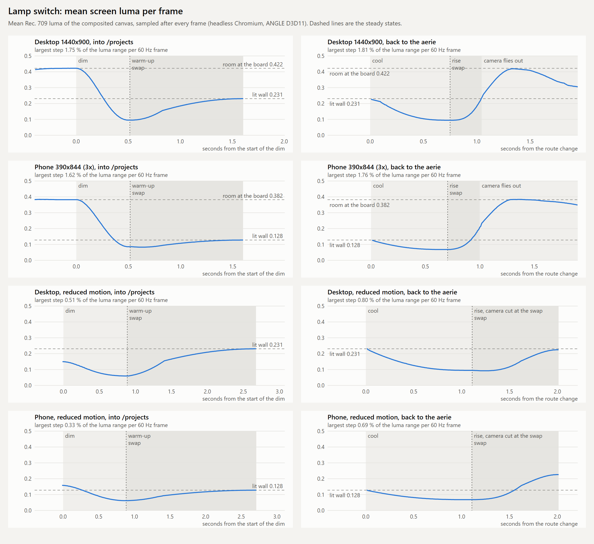
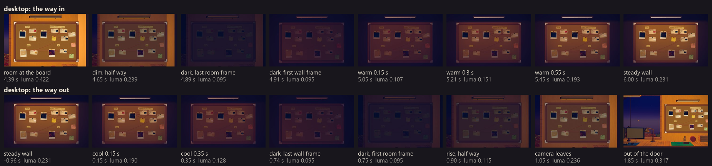
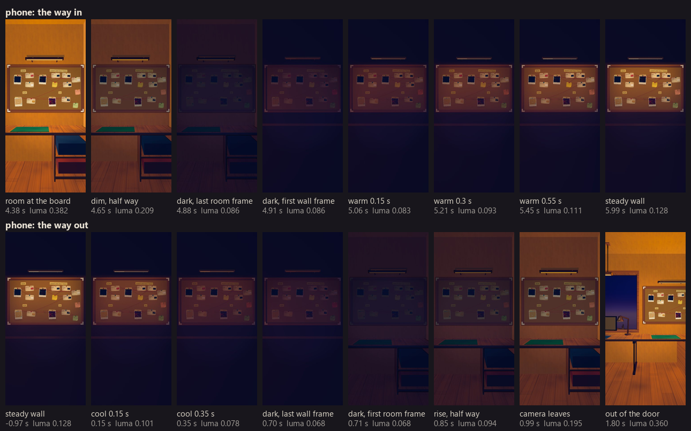
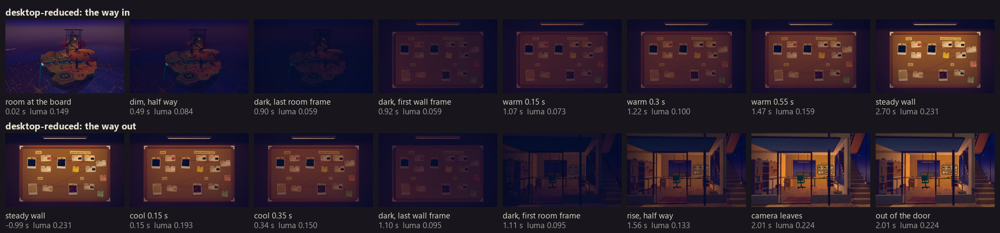

# The lamp switch into the evidence wall (3 November 2026)

The owner found the move from the aerie into `/projects` "kinda weird and not smooth", because the
room board and the lit wall are different models. A dissolve faded a still of the room over the
wall scene. The lamp switch replaces it both ways. The code is in `src/scene/aerie/light-switch.js`,
`src/scene/scene-manager.js` (`enterWall`, `stepBoard`, `lightAt`) and `src/scene/aerie/wall-light.js`
(`setLamp`).

## The sequence

| Step | Full motion | Reduced motion |
|---|---|---|
| Camera | Flies in through the workshop door and rests at the board. | No flight. The dim starts where the camera is. |
| Dim | The room exposure falls to 0.042 of its light over 0.5 s. | To 0.1 over 0.9 s. |
| Swap | At the dark point, under a still that fades out over 0.3 s. | The same, over 0.5 s. The camera cut hides under it. |
| Warm-up | The filament glows first in deep amber. The light rises to its steady colour over 1.1 s. | Over 1.8 s. |
| Way out | The lamp cools over 0.7 s with an afterglow, swaps at the dark point, and the room rises over 0.6 s. The camera leaves through the door when the room light is half way back. | Cool 1.1 s, rise 0.9 s. The camera cuts to its stop at the swap. |

One number p holds the place on the track. 0 is the room lit, 1 is the dark point and 2 is the
lamp at its steady state. A new switch starts from the place that the last one reached. A
visitor who turns back halfway sees the light turn back from where it is, with no jump.

## Choices the probe made

- **The room dims through the tone mapping exposure, not `uFade`.** `uFade` darkens the frame
  after the grade adds its lifted blacks. Then the dark room read brown and the dark wall read
  indigo. Through the exposure, the dark room takes the same tone curve and the same lift as the
  dark wall, and the two dark frames match in colour. `grade-pass.js` is unchanged.
- **The dark point is 0.042 of the room exposure.** At that share the room copy at the board
  matches the wall under its fill and desk light alone (0.048 on a desktop, 0.037 on a phone).
  The fill then stays steady, and only the lamp warms. In luma the dark point is about a quarter
  of the room, not black.
- **The dim and the rise ease on a gamma curve.** A linear dim dropped most of the seen light
  in its last frames.
- **The fill never starts above its steady value.** A shallower reduced motion dark point would
  need more fill than steady, and the shade would then darken while the lamp warms. The still
  blend at the swap covers the gap.
- **A long frame moves the switch by 1/30 s at most.** The route change stalls a frame for
  about 67 ms, and the cool jumped 2.7 percent there before this cap.
- **The room copy shows the brass lamp,** off, with a faint amber lip at the dark point. The
  screen never goes empty, and the wall lamp at the swap has a lamp to match.

## Measurements

The probe drives the real page in headless Chromium (ANGLE D3D11), and samples the mean luma of
the canvas after every frame. A still over the canvas counts by its opacity. The steps are on the
trace resampled to 60 Hz.

| Run | Dim | Warm-up | Cool | Rise | Frames above steady |
|---|---|---|---|---|---|
| Desktop 1440x900 | 1.75 % | 0.59 % | 0.80 % | 1.80 % | 0 |
| Phone 390x844 at 3x | 1.62 % | 0.17 % | 0.41 % | 1.72 % | 0 |
| Desktop, reduced motion | 0.39 % | 0.50 % | 0.68 % | 0.62 % | 0 |
| Phone, reduced motion | 0.33 % | 0.20 % | 0.30 % | 0.70 % | 0 |

- No warm-up frame is brighter than the lit wall. No rise frame is brighter than the room.
- Each way makes one fall and one rise of light. No run has a WCAG 2.3.1 flash in any second.
- The room at the board (luma 0.42 on a desktop) is brighter than the lit wall (0.23). That was
  so before. On the way in, the first frame is the brightest one, and the light falls once and
  rises once.
- Two interrupt probes, on a desktop. First, reduced motion turns on during the dim: the largest
  step is 1.52 %. Second, a text page and then `/skills` during the cool: the way out keeps its
  lamp switch and swaps at the dark point. The telescope flight then passes the workshop walls,
  which master does too.

### Frames

## For another room

`light-switch.js` imports nothing, so any lazy room part can import it. A room makes a switch
with `createLightSwitch({ on, at, before, reduced })` and calls `step(dt)` each frame. It sets
the old scene exposure from `roomLight(p, dark)` and its lamp from `max(0, p - 1)`, with
`filament` and `bulbColor` for the bulb. It calls `fadeStill` on the step that returns `swap`.
The dark point needs a probe for each pair of scenes, as `DARK_MATCH` in `wall-light.js` shows.
